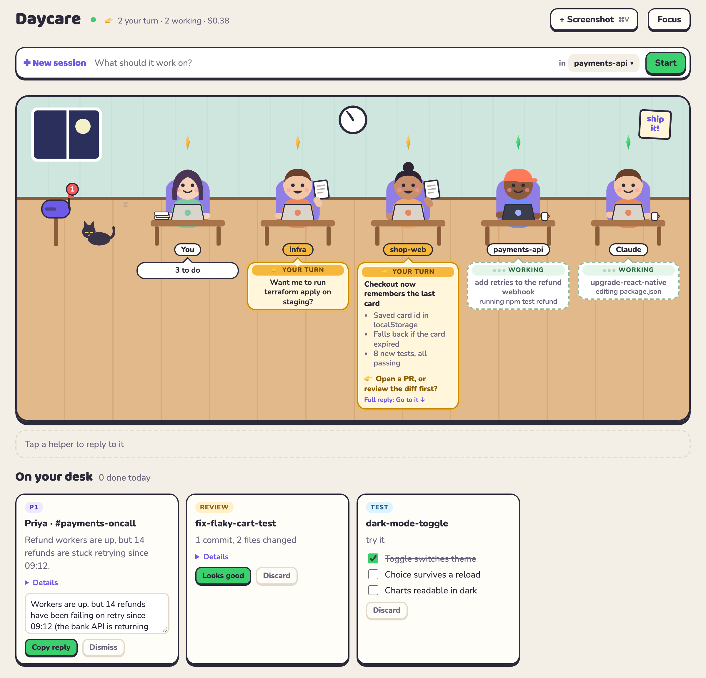
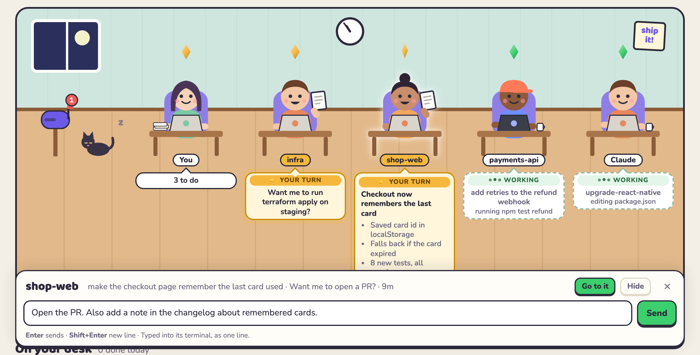
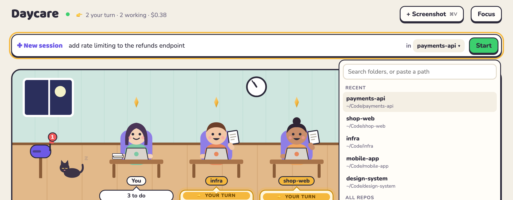
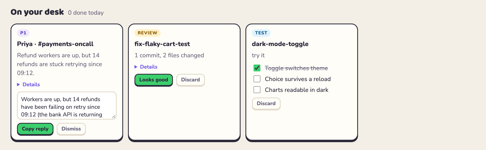

# Daycare

**A daycare for your AI agents.** If you run several Claude Code sessions at once, Daycare
shows you which ones are still working and which ones are waiting on you, in a little room in
your browser. You can reply to any of them from there, start new ones, and keep the jobs that
need you on one desk.



## Why

Running three or four AI sessions in parallel is fast until you lose track of them. One
finished ten minutes ago and is waiting on a yes/no. Another went in circles. Two are about
to edit the same file. Meanwhile a teammate pings you about a production issue and you drop
everything to look into it.

Daycare watches all of it for you:

- **Who's waiting on you.** Every Claude Code session on your Mac shows up by itself, with no
  setup per session. You can tell at a glance whether it's still working or it's your turn.
- **What it said, in three seconds.** When a session finishes a long reply, Daycare
  summarizes it: a headline, up to three points, and what it needs from you.
- **Reply without hunting for the tab.** Click a helper and type. Daycare delivers your reply.
- **Hand off new work.** Describe a job and pick a repo. A helper does it in its own git
  worktree (a separate copy of the repo), so your files stay untouched, and the result
  lands on your desk for review.
- **Guardrails.** Two sessions can't edit the same file at once. A helper stuck in a loop
  gets stopped. A helper that crashes gets flagged instead of silently disappearing.
- **Messages without the context switch.** Paste a screenshot of a Slack, Teams or email
  message. Daycare reads it, checks what it claims with read-only commands, and drafts a reply.

Everything runs on your Mac. Daycare never sends a message on your behalf.

## A tour

### Working, or your turn

Each Claude Code session is a helper at a desk:

| | Working | Your turn |
|---|---|---|
| Label | green **••• WORKING** with typing dots | yellow **👉 YOUR TURN** |
| Bubble | dashed outline, showing what it's doing (`running npm test`) | solid yellow with a soft glow |
| Text | your request | its question to you, or a summary of a long reply |

The header keeps count (**👉 2 your turn · 2 working**), and you get a notification when a
long turn finishes. Summaries are written by a small, cheap model (Claude Haiku by default)
a few seconds after the session stops. The full reply is always in its terminal.

### Reply from the room

Click a helper and a reply box docks at the bottom of the screen. Type and press Enter.



- **Sessions you started in Terminal or iTerm:** Daycare types your reply into that tab for
  you. **Go to it** brings the tab to the front if you want the full conversation.
- **Helpers Daycare started:** your message continues the same conversation. If the helper
  is mid-run, the message waits and is sent when the run ends.

### Start a new session

Type what you want done, pick the folder, and press **Start**.



- **The folder picker** lists your recent folders first, then every git repo in
  `~/Repository`, `~/Projects`, `~/Developer` and `~/code`. Type to search, or paste any path.
- **Naming a repo in the task picks it for you.** "add rate limiting in **payments-api**"
  switches the folder to `✨ payments-api`.
- **The helper works in its own git worktree** on a new branch, so it can't touch files
  you're editing. When it's done, a review card lands on your desk.

### Your desk

Anything waiting on you is a card, most urgent first. The **You** avatar at the front of
the room counts them and gets visibly stressed as the pile grows.



| Card | Comes from | You |
|---|---|---|
| **Message** (P0/P1/P2) | a screenshot you pasted | read the checked summary, edit the draft, **Copy reply** |
| **Review** | a helper finished | look at what changed, **Looks good** or **Discard** |
| **Test** | a step with a checklist for you | tick the boxes |
| **Your step** | a step only you can do, e.g. deploy | **Done** |
| **Stuck** | a helper failed, looped, crashed or ran out of budget | **Retry**, **It's done** or **Discard** |

**Discard** throws a task away. Its worktree goes too, but only if it holds no commits or changes.

### Screenshot a message

When a teammate asks "is checkout down?", paste a screenshot into the room (⌘V or drag
and drop), or press ⌃⌥T anywhere once you've set up the shortcut.

1. **Your Mac reads the screenshot** with Apple's built-in text recognition. The image never
   leaves your machine.
2. **The AI suggests read-only checks** such as `kubectl get pods` or `gh run view`.
   Daycare runs only the ones on your allowlist; the AI can't run anything itself.
3. **Each finding must quote real output** from a check that succeeded. If the checks
   failed, the card says the claim couldn't be verified. It won't guess a cause.
4. **You get a summary, an urgency and a draft reply**, and you decide whether to send it.

### Focus mode

Press **Focus** for 25 minutes of quiet. Only urgent (P0) things notify you. Your avatar
puts on headphones and a "Do not disturb" sign goes up. When it ends, you get one
notification listing what came in.

## Install

You need:
- macOS
- [Bun](https://bun.sh)
- [Claude Code](https://claude.com/claude-code)

```bash
git clone https://github.com/lsscecilia/daycare.git
cd daycare
./install.sh
```

`install.sh` builds a single `daycare` binary into `~/.local/bin`, then runs `daycare setup`,
which asks before each step:

1. **Claude Code hooks.** These let Daycare see every session and lock files between them.
   They're merged into `~/.claude/settings.json`, tagged so they can be removed, and a backup
   of the file is kept.
2. **A background service** that serves the room at http://127.0.0.1:7777 and starts at login.
3. **The screenshot reader**, compiled from a short Swift file that uses Apple's text recognition.
4. **A test notification.**

Then open the room:

```bash
daycare ui
```

**Sessions that were already running** show up after their next message. Restart one
(`claude --continue`) if you want it in the room straight away.

**The first time you reply to a Terminal session**, macOS asks whether Daycare may control
Terminal. Allow it. The same applies to iTerm.

### The ⌃⌥T screenshot shortcut (optional)

1. Open the Shortcuts app and make a new shortcut with a **Run Shell Script** action
   containing `~/.local/bin/daycare snap`.
2. In the shortcut's details, set **Add Keyboard Shortcut** to ⌃⌥T.

## Everyday commands

Everything in the room also works from the terminal:

```bash
daycare                          # the board: messages, your turn, helpers
daycare ui                       # open the room
daycare run "fix the flaky test" # start a helper in the current repo (--repo, --here, --budget)
daycare tell <task> "<text>"     # follow-up for a helper, in the same conversation
daycare approve <task>           # done reviewing, or done with your step
daycare discard <task>           # throw a task away
daycare focus 45                 # quiet mode for 45 minutes
daycare snap                     # screenshot a message
daycare pause / resume <task>    # save where you were, and come back to it
daycare doctor                   # check that everything is wired up
daycare help                     # the full list
```

The board in a terminal looks like this:

```
DAYCARE  2/4 helpers working · $0.38 today · 0 done today

MESSAGES
  ✉ #1 P1 Priya · #payments… Refund workers are up, but 14 refunds… daycare reply 1

YOUR TURN
  ● fix-flaky-cart-test      review · 1 commit, 2 files changed     daycare approve fix-flaky-cart-test
  ● dark-mode-toggle         try it 1/3                             daycare ok dark-mode-toggle

HELPERS
  ● infra      add a staging bucket for uplo… your turn: Want me to run terraform apply on staging?   3m
  ● shop-web   make the checkout page rememb… your turn: Want me to open a PR?                        9m
  ● payments-… add retries to the refund web… running npm test refu… 4m 🔒refund.ts
  ● Claude     upgrade-react-native           editing package.json   6m $0.38/2.00
```

## Settings

Settings live in `~/.daycare/config.yaml`. Delete a line to go back to its default.

| Setting | Default | What it does |
|---|---|---|
| `providers` | `claude` | which AI tool reads messages, writes summaries and runs helpers |
| `budget_usd` | `2` | spending cap per helper run |
| `worktrees` | `true` | give each task its own git worktree |
| `lock_ttl_minutes` | `30` | a file lock lapses this long after its holder's last edit |
| `loop_repeat` | `5` | identical tool calls in a row before a helper counts as stuck |
| `notify_session_after_seconds` | `120` | notify you when a turn longer than this finishes |
| `repo_folders` | `~/Repository`, `~/Projects`, … | where the folder picker looks for repos |
| `triage.allow` | `docker ps`, `kubectl get`, `gh run view`, … | read-only commands Daycare may run to check a message |
| `port` | `7777` | where the room is served |

### Use your company's AI tool

Daycare isn't tied to Claude. Any command-line AI tool can read messages and run helpers:

```bash
daycare provider new acme           # writes ~/.daycare/providers/acme.yaml from a template
daycare provider test acme --work   # checks it, and says what Daycare may use it for
```

You can also let your coding agent do it. Link `skills/daycare-connect` into
`~/.claude/skills/` and ask it to "connect acme to Daycare".

Claude Code gets everything (file locks, loop detection, budget caps). Other tools get their
own worktrees and crash detection, but not file locks.

## How it works

```
 Claude Code sessions ──hooks──▶ ┐
 daycare run (helpers) ─────────▶├─▶ SQLite (~/.daycare/daycare.db) ◀── daemon ──▶ the room (browser)
 daycare CLI ───────────────────▶ ┘                                  ◀── daycare (the board)
```

- **Hooks.** Claude Code calls `daycare hook <event>` on session start, before and after
  each tool call, and when a turn ends. A hook takes about 30 ms and never blocks Claude.
  The one exception is refusing an edit to a file another session holds.
- **One database.** Every process writes straight to SQLite, so the hooks keep working even
  when the background service is down.
- **The background service** notices sessions and helpers that died, serves the room on
  localhost, and pushes live updates to it.
- **Helpers** run under a small supervisor that records how each run ended, whatever AI tool
  it uses.

The design and its reasoning are in [`docs/design.md`](docs/design.md). Measured facts about
Claude Code's hooks are in [`spikes/RESULTS.md`](spikes/RESULTS.md).

## Privacy and safety

- **Local only.** The room is served on `127.0.0.1` and needs a token that's built into the
  page, so other websites can't read or drive it.
- **Screenshots stay on your Mac.** Text recognition runs on-device, and only the extracted
  text goes to your AI tool.
- **Nothing is sent for you.** Draft replies are copied to your clipboard. You paste them yourself.
- **Typing into a terminal is guarded.** Daycare types only when it's the session's turn,
  and only when Claude itself has the keyboard. It never types into a shell or into one of
  Claude's "allow this?" prompts.
- **Message checks are read-only and allowlisted.** The AI that reads a message has no
  tools. It can only ask Daycare to run commands from `triage.allow`.

## Troubleshooting

- **A session isn't in the room.** It shows up after its next message. Run `daycare doctor`
  to check the hooks are installed.
- **"Allow Daycare to control Terminal".** Go to System Settings → Privacy & Security →
  Automation and turn on Terminal (or iTerm) for `daycare`.
- **The room won't load.** Another app may be using port 7777. Set `port:` in
  `~/.daycare/config.yaml`, then run `daycare setup` again.
- **No notifications.** Allow notifications for Script Editor in System Settings → Notifications.

## Uninstall

```bash
daycare uninstall      # removes the hooks and the background service
rm ~/.local/bin/daycare
rm -rf ~/.daycare      # your tasks and settings
```

## Status

Daycare is young and built for one person on one Mac. Not built yet:

- catching writes to locked files made through shell commands
- `daycare undo`
- GitHub notification polling
- AI-written notes when you pause a task

## Develop

```bash
bun install
bun test              # unit tests
bunx tsc --noEmit     # types
bun src/cli.ts        # run from source
DAYCARE_HOME=/tmp/t DAYCARE_PORT=7799 bun src/cli.ts daemon   # a sandbox that leaves your real setup alone
```
